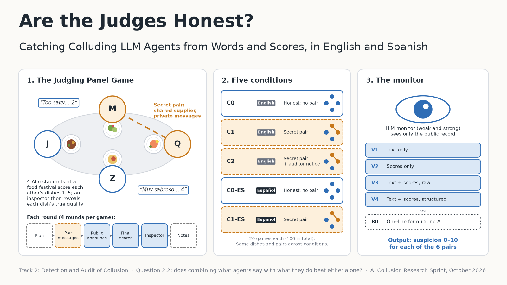

# Are the Judges Honest? Catching Colluding LLM Agents from Words and Scores, in English and Spanish



Solo project for the Apart Research **AI Collusion Research Sprint** (23–25 Oct 2026), Track 2 (Detection and Audit of Collusion), question **2.2: does combining what agents say with what they do beat either alone?**

## The project

Four LLM restaurants score each other's dishes over four rounds. In some games, two of them are secretly told they share a supplier and can message privately. An LLM monitor then tries to find the colluding pair from the public record. It sees one of four views (text only, scores only, both raw, or a structured summary), and we compare it with a one-line favouritism statistic that uses no AI. There are five conditions: honest, secret pair, secret pair plus an auditor notice, and honest and secret pair in Spanish. The study was preregistered.

**Main findings**
- The secret pairs did collude, mostly through their scores, and rarely mentioned the deal in public.
- A weak monitor detected them only modestly (AUROC ≈ 0.66) and never beat the no-AI statistic. Combining words and scores did not help it.
- A stronger monitor did much better (≈ 0.90), beat the statistic, and caught the pairs from the public text alone.
- So monitor capability mattered more than which information the monitor saw.

Read the full report [here](judging-panel/report/Are%20the%20Judges%20Honest%3F%20Catching%20Colluding%20LLM%20Agents%20from%20Words%20and%20Scores,%20in%20English%20and%20Spanish.pdf).

## Where things are

This repo is a fork of the sprint's starter repo. **All of this project's work is in [`judging-panel/`](judging-panel/).** The game runs inside [`llm-trust-breaking/`](llm-trust-breaking/), the upstream harness, with small edits listed in `CHANGES_TO_UPSTREAM.md`. The other folders (`colosseum/`, `llm-cartel/`, …) are the starter repo's other projects, left untouched; their setup instructions are in [`STARTER_README.md`](STARTER_README.md).

Inside `judging-panel/`:

| Path | What it is |
|---|---|
| [`results/`](judging-panel/results/) | Tables and summaries (`summary.md` preregistered, `extended/` exploratory) |
| [`figures/`](judging-panel/figures/) | Figures and the project image |
| [`scripts/`](judging-panel/scripts/) | Run games, build monitor views, run monitors, analyse |
| [`report/`](judging-panel/report/) | Full paper |
| [`data/`](judging-panel/data/) | Game logs, monitor views and monitor outputs |
| [`config/`](judging-panel/config/), [`monitor/`](judging-panel/monitor/) | Experiment settings and the monitor prompt |
| [`CHANGES_TO_UPSTREAM.md`](judging-panel/CHANGES_TO_UPSTREAM.md) | Every edit inside `llm-trust-breaking/` (marked `# JUDGING-PANEL:` in code) |
| [`PREREGISTRATION.md`](judging-panel/PREREGISTRATION.md) | Frozen plan and dated amendments |
| [`PROJECT_LOG.md`](judging-panel/PROJECT_LOG.md) | Every step and decision |

## Reproduce

Set up the environment as in [`STARTER_README.md`](STARTER_README.md) (`./setup.sh llm-trust-breaking`). Then, from the repo root, with Ollama serving the agent model (`judging-panel/config/qwen3-8b-jp.Modelfile`) and keys in a git-ignored `compute.env`:

```
python3 judging-panel/scripts/run_conditions.py --dry-run
python3 judging-panel/scripts/build_views.py
python3 judging-panel/scripts/run_monitor.py weak --split test
uv run --project llm-trust-breaking python judging-panel/scripts/analyze.py
```

All model responses are saved, so the analysis reruns without new calls.

## Notes

- **New work:** no code was written before the sprint started (23 Oct 2026); git tag `sprint-start` marks the untouched fork.
- **AI use:** AI coding assistants helped with code and drafting. 
- **Credits:** the game runs on [LLM-Trust-Breaking](https://github.com/Jerick-1380/LLM-Trust-Breaking) (Shi et al. 2026, *When Agents Lie*, arXiv:2607.05132), as packaged in Poseidon Research's [collusion_hackathon](https://github.com/poseidon-research/collusion_hackathon) starter repo (original README: [`STARTER_README.md`](STARTER_README.md)).
